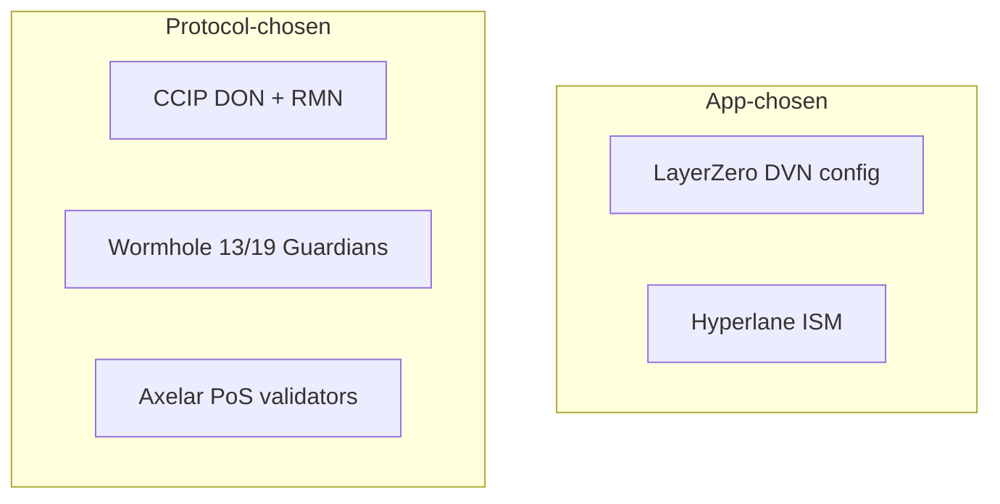

# Verification Models Compared

This chapter describes how each protocol verifies messages, per its public documentation at the time of writing. Designs, defaults and contracts change; check current docs and deployed contracts before relying on any line below.

## Summary table

| Protocol | Who attests | Threshold | Who chooses the verifiers | Execution |
|---|---|---|---|---|
| LayerZero v2 | Decentralized Verifier Networks (DVNs): independent services, some run by third parties, some using other bridges or ZK proofs | App-configured: required DVNs plus optional DVNs with an optional-threshold | The application (OApp); a default config exists if the app sets none | Executors (permissionless delivery after verification) |
| Chainlink CCIP | Committing and executing decentralised oracle networks (DONs), plus a separately implemented Risk Management Network (RMN) that can bless or "curse" | DON and RMN quorums set by Chainlink | Chainlink, per lane | Executing DON; manual execution fallback |
| Hyperlane | Validators sign checkpoints; verification logic lives in an Interchain Security Module (ISM) | Set in the ISM (for example m-of-n multisig) | The receiving application, or the Mailbox's default ISM if the app sets none | Permissionless relayers |
| Wormhole | 19 Guardians observe and sign Verified Action Approvals (VAAs) | 13 of 19 signatures | Wormhole governance (Guardian set) | Anyone can submit a VAA; relayers optional |
| Axelar | Axelar network validators (proof-of-stake chain) vote on events; gateways verify signatures from the validator set | Stake-weighted threshold | Axelar network | Relayers submit approvals; anyone can execute approved calls |

## LayerZero v2

LayerZero separates verification from execution. On each pathway, an OApp configures a **send library** and **receive library** (the Ultra Light Node message library) and, inside it, a DVN configuration: a set of required DVNs (all must verify), a set of optional DVNs, and how many optional DVNs must verify. Once the configured DVNs verify a packet's payload hash, it can be committed and any executor can deliver it to the OApp's `lzReceive`.

So security depends on the DVNs the app picks: one required DVN means one party can forge messages. If an app never sets its config, it inherits the endpoint's default for that pathway, which LayerZero can change. LayerZero's own documentation recommends that applications set their configuration explicitly. Chapter 3 shows how to read and pin it.

## Chainlink CCIP

CCIP uses Chainlink DONs to commit Merkle roots of messages on the destination and to execute them. A separate Risk Management Network, built as an independent implementation, monitors lanes. It must "bless" committed roots before execution, and can "curse" a lane or chain to halt it if it detects anomalies. Token transfers go through token pools that have per-lane rate limits (token buckets) configured by the token's admin.

Applications do not choose verifiers; they trust Chainlink's DON and RMN operation. They do choose which source chains and senders to accept in `ccipReceive`, and token issuers set rate limits.

## Hyperlane

Hyperlane's `Mailbox` contract on each chain dispatches and processes messages. On delivery, the Mailbox asks the recipient for its **ISM** (via `interchainSecurityModule()`); if the recipient returns none, the Mailbox uses its default ISM. Common ISM types:

| ISM | Verifies |
|---|---|
| Multisig (message ID or Merkle root variants) | m-of-n validator signatures over a checkpoint |
| Aggregation | m-of-n other ISMs must pass |
| Routing | Chooses an ISM per origin chain |
| Custom | Any logic the app writes, such as a light client or another bridge |

As with LayerZero, weak or default ISMs make weak apps.

## Wormhole

Guardians observe messages emitted by the Wormhole core contract on each connected chain and sign them. A VAA with signatures from 13 of 19 Guardians is valid on every chain. The core contract's `parseAndVerifyVM` checks signatures against the current Guardian set. The receiving app must check the emitter chain and emitter address inside the VAA and track consumed VAAs to stop replay. Wormhole also runs a Governor that rate-limits token outflows per chain, and its Native Token Transfers (NTT) framework adds per-token rate limits.

## Axelar

Axelar is a proof-of-stake chain whose validators run nodes for connected chains and vote on whether events happened. Approved calls are signed by the validator set (using threshold or weighted-multisig schemes, per the docs for each version) and submitted to the destination **gateway**. Apps inherit from `AxelarExecutable`, whose `execute` checks with the gateway that the call was approved before calling the app's `_execute(sourceChain, sourceAddress, payload)`. The app must check `sourceChain` and `sourceAddress`. Axelar's Interchain Token Service adds flow limits for tokens.

## Comparing trust

App-chosen designs let a careful app require, say, two independent DVNs or an aggregation ISM, and let a careless app sit on one verifier. Protocol-chosen designs give every app the same baseline.

## Worked example

_Not executed in this book's CI; verify locally._

Read verification configuration from deployed contracts on a local fork.

1. Fork a chain where an OApp you want to study is deployed: `anvil --fork-url $RPC`.
2. Find the LayerZero `EndpointV2` address for that chain in LayerZero's deployed-contracts docs. Call `getReceiveLibrary(oapp, srcEid)` and then `getConfig(oapp, lib, srcEid, 2)` (config type 2 is the ULN config in current docs) with `cast call`, and decode the returned bytes as the ULN config struct (confirmations, required DVN count, optional DVN count, threshold, DVN addresses).
3. For a Hyperlane warp route, call `interchainSecurityModule()` on the router. If it returns zero, call `defaultIsm()` on the Mailbox. Then call `moduleType()` and, for a multisig ISM, `validatorsAndThreshold(message)` with a sample message.
4. Record the results in the summary table for that specific app.

## Common pitfalls

- Comparing protocols by headline design while ignoring app-level configuration.
- Assuming a DVN or ISM name means independence; check who runs it.
- Forgetting that the RMN or Guardian set can halt as well as approve.
- Reading config once; defaults and libraries can change after deployment.

## Exercises

1. Pick one token on two protocols (for example, an OFT and a Hyperlane warp route) and write the exact verifier set and threshold for each, from on-chain reads.
2. Write a Python script that decodes LayerZero ULN config bytes into a readable dict.
3. Design an aggregation ISM requiring a multisig plus an independent proof source; state the liveness cost.

## Further reading

- LayerZero v2 docs, DVN and configuration pages: <https://docs.layerzero.network>
- Chainlink CCIP architecture docs: <https://docs.chain.link/ccip>
- Hyperlane ISM docs: <https://docs.hyperlane.xyz>
- Wormhole Guardians and VAAs docs: <https://wormhole.com/docs>
- Axelar General Message Passing docs: <https://docs.axelar.dev>
