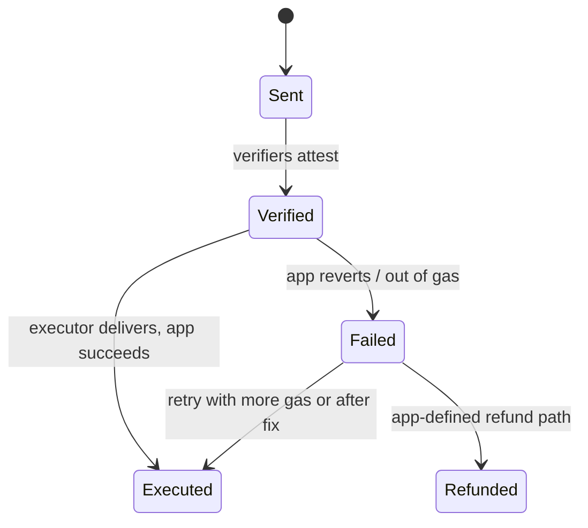

# Replay, Ordering and Execution

Once a message is verified, it still has to be executed exactly once, in an order the application can live with, with enough gas, and with a plan for when execution fails. These are not forgery problems, but they lose money all the same: double mints, stuck funds, and channels that block every later message.

## Replay protection

Each protocol tracks delivered messages, but the app often adds its own layer. Know which layer protects what.

| Protocol | Protocol-level replay protection (per docs) | App responsibility |
|---|---|---|
| LayerZero v2 | Endpoint tracks inbound nonces per (receiver, source EID, sender); a packet executes once | Handle retries idempotently |
| Chainlink CCIP | OffRamp tracks execution state per message; manual execution only for failed messages | Idempotent handling if app logic is retried |
| Hyperlane | Mailbox records delivered message IDs | Do not reuse message IDs as app nonces across mailboxes |
| Wormhole | Core contract verifies signatures only | App must store consumed VAA hashes (or sequence per emitter) |
| Axelar | Gateway marks approved commands executed when the app validates them | Use `AxelarExecutable` so validation is consumed once |

The highest-risk case is a raw signature-based design, such as a direct Wormhole integration, where the app forgets to mark the VAA consumed:

```solidity
function receiveMessage(bytes calldata encodedVM) external {
    (IWormhole.VM memory vm, bool valid, string memory reason) = wormhole.parseAndVerifyVM(encodedVM);
    require(valid, reason);
    require(vm.emitterChainId == SOURCE_CHAIN && vm.emitterAddress == SOURCE_EMITTER, "emitter");
    require(!consumed[vm.hash], "replay");      // without this line, the same VAA works forever
    consumed[vm.hash] = true;
    _handle(vm.payload);
}
```

Also check for **cross-deployment replay**: the same app deployed on several destination chains, all accepting a message whose payload does not name its intended destination. Include the destination chain and contract in the payload, or rely on protocol-level addressing that does.

## Ordering

| Semantics | Meaning | Risk |
|---|---|---|
| Ordered | Message n+1 cannot execute before message n | One failing message blocks all later ones |
| Unordered | Any verified message can execute any time | App logic must tolerate reordering |

LayerZero v1 used blocking, ordered delivery by default: if `lzReceive` reverted, the payload was stored and the channel blocked until it was retried or force-resumed. Many v1 apps used a "non-blocking" pattern that caught errors and stored failed messages for later retry. LayerZero v2 executes unordered by default after verification, with ordered execution as an option. CCIP added an `allowOutOfOrderExecution` flag in its extra-args for supported lanes. Hyperlane processes messages independently. Check the current docs for each.

If app logic depends on order (for example, "set price" then "liquidate"), either use ordered delivery and handle blocking, or include sequence numbers in the payload and enforce them in the app with a buffer for early arrivals.

## Gas and execution failure

Destination execution can fail because:

- the gas limit passed with the message is too low;
- the receiving contract reverts (paused token, blacklisted recipient, logic bug);
- the payload is malformed or too large.

Design questions:

1. **Who sets the gas limit?** If a user can choose it, can they choose one too low on purpose, so the message fails in a way that benefits them (for example, a failed refund path)?
2. **Is failure recoverable?** LayerZero v2 lets the executor or anyone retry execution of a verified packet; CCIP supports manual execution; Hyperlane lets anyone re-call `process` if the message was not delivered; Axelar lets anyone call `execute` again for an approved, unexecuted command. Confirm that retries are possible and do not need privileged keys.
3. **Are tokens safe while a message is pending?** For a lock-and-mint transfer, tokens are locked on source; if the destination fails permanently, is there a refund path?
4. **Does the app use try/catch correctly?** Catching all reverts and dropping the message is worse than blocking: it silently loses value.



## Admin actions on channels

Some protocols give the app owner tools to skip, clear or burn a nonce (LayerZero v2 documents such functions for the OApp delegate) or otherwise discard messages. These exist to unblock channels, but they also let a compromised delegate destroy legitimate messages, such as a user's incoming token transfer. Treat them as privileged, log their use, and protect them with a multisig.

## Worked example

_Not executed in this book's CI; verify locally._

Demonstrate a VAA replay bug and an ordering bug in Foundry without a live network.

1. Write a `MockWormhole` with `parseAndVerifyVM` that accepts any VM signed by a single test key (use `vm.sign` to produce signatures) and returns a `hash` of the body.
2. Write `ToyReceiver` with the `receiveMessage` function above, but omit the `consumed` check. Test that submitting the same encoded VM twice mints twice.
3. Add the check and confirm the second submission reverts.
4. For ordering, write `ToyPriceThenAct` that expects message 1 ("set price") before message 2 ("act at price"). Deliver message 2 first in a test and show it acts on a stale price.
5. Add an app-level sequence number and a pending buffer; deliver in reverse order and assert the final state matches in-order delivery.
6. Using LayerZero's devtools test helper, write a test where `_lzReceive` reverts for one packet and confirm later packets still execute (unordered) and the failed one can be retried.

## Common pitfalls

- Verifying a VAA or signature without recording it as consumed.
- Payloads that do not bind the destination chain and contract.
- Catch-all try/catch that drops failed messages.
- User-controlled gas limits with no minimum.
- Treating nonce skip or clear functions as harmless maintenance.

## Exercises

1. For each protocol, find in the docs or code where delivered messages are recorded and write the storage key used.
2. Write a Foundry invariant test for a toy bridge: tokens minted on destination never exceed tokens locked on source, across random delivery orders and failures.
3. Write a policy for when your app's delegate may use nonce-skip functions, including the evidence required.

## Further reading

- LayerZero v2 message execution docs: <https://docs.layerzero.network>
- Chainlink CCIP manual execution docs: <https://docs.chain.link/ccip>
- Hyperlane Mailbox docs: <https://docs.hyperlane.xyz>
- Wormhole VAA docs: <https://wormhole.com/docs>
- Axelar GMP docs: <https://docs.axelar.dev>
